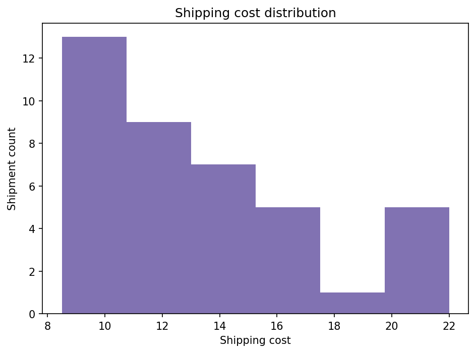

# Logistics Analysis Report

## Introduction and background
This project explores shipment delivery performance, shipping mix, delivery delays, and shipping costs to support evidence-based logistics planning.

## Problem statement and objectives
Operational teams need a repeatable way to inspect shipment data, measure service and cost KPIs, and identify improvement opportunities. Objectives are to validate incoming data, calculate available KPIs, visualize supported measures, and evaluate a cautious late-delivery model only when data is sufficient.

## Dataset description and source
- Input file: `synthetic_logistics_sample.csv`
- Dataset designation: **synthetic**. **This is a synthetic testing dataset; its values are not real-world findings.**
- For real data, obtain the DataCo Smart Supply Chain dataset from the Kaggle dataset page listed in the project README and data guide. Follow the current listing's license and terms; this project does not bundle or redistribute that dataset.

## Data cleaning methodology
Column names are matched through documented aliases. Recognized dates and operational numeric measures are parsed with invalid non-empty values reported as missing. Original rows and columns are retained; duplicates are reported, not removed. No cleaned source CSV is exported by default to avoid publishing potentially sensitive records.

Cleaning and data-quality notes:
- Parsed 'Order Date' as a date; 0 non-empty value(s) were invalid.
- Retained all 40 rows; 0 duplicate row(s) were identified but not removed.
- No rows or columns were silently dropped.

## KPI definitions and results
- **Total shipments:** number of input rows; duplicate records are retained.
- **On-time rate:** known on-time/early deliveries divided by shipments with a classifiable outcome.
- **Late rate:** known late deliveries divided by shipments with a classifiable outcome.
- **Average shipping cost:** arithmetic mean of parseable recognized shipping-cost values.
- **Average delivery time:** arithmetic mean of parseable actual delivery-time values in days.
- **Shipment count by mode:** rows per recognized shipping-mode category.

| KPI | Result |
|---|---:|
| Total shipments | 40 |
| On-time delivery rate | 62.5% |
| Late delivery rate | 37.5% |
| Outcome records with known status | 40 |
| Average shipping cost | 13.47 |
| Average delivery time (days) | 3.58 |
| Average delay (days; positive means late) | 0.47 |
| Shipment count by mode | First Class: 8, Same Day: 6, Second Class: 10, Standard Class: 16 |

## Exploratory data analysis and charts
### Delivery Status

Observed delivery-status counts: Advance shipping: 12, Late delivery: 15, Shipping on time: 13.
### Shipping Mode Analysis

Observed shipment counts by mode: First Class: 8, Same Day: 6, Second Class: 10, Standard Class: 16.
### Delivery Delay Analysis

The plotted delay values are centered on an observed mean of 0.47 days; positive values mean late.
### Shipping Cost Analysis

The plotted costs have an observed mean of 13.47 in the source currency.

Interpretations are descriptive, not causal. Charts that could not be generated are omitted because their source fields were unavailable or empty.

## Machine learning methodology and evaluation
Model: Logistic Regression with median/mode imputation, numeric scaling, and one-hot encoding.
Target: late delivery (1) versus known on-time/early delivery (0).
Evaluation: stratified 75/25 train/test split; random_state=42.
Leakage controls: delivery outcome, actual delivery time, schedule, and delay fields are excluded from predictors.
Predictors: Shipping Cost, Order Item Quantity, Order Item Total, shipment_month, shipment_day_of_week, Shipping Mode.
Train rows: 30; test rows: 10.
Holdout metrics:
  - accuracy: 0.8000
  - balanced_accuracy: 0.8333
  - precision: 0.6667
  - recall: 1.0000
  - f1: 0.8000
  - roc_auc: 0.7917
Metrics describe this dataset and split; they are not a guarantee of future performance.

## Exploratory clustering
Exploratory K-means clustering used 40 rows and 6 numeric feature(s): Shipping Cost, Days for Shipping (Real), Days for Shipment (Scheduled), Delivery Delay Days, Order Item Quantity, Order Item Total.
Features were median-imputed and standardized. Cluster IDs are descriptive, not quality rankings.
Cluster mean profiles:
         Shipping Cost  Days for Shipping (Real)  Days for Shipment (Scheduled)  Delivery Delay Days  Order Item Quantity  Order Item Total
cluster
0                20.87                      1.00                           1.00                 0.00                 1.50             74.33
1                12.99                      2.63                           3.26                -0.63                 2.37            101.11
2                11.11                      5.80                           3.73                 2.07                 2.40            110.27
Validate whether these groupings are operationally meaningful before making decisions.

## Key findings
The results above describe only this synthetic test sample and must not be interpreted as findings about real operations.

## Recommendations
- Review delay and on-time rates by route, mode, and service commitment before adjusting schedules.
- Compare like-for-like shipping modes and lanes to identify cost/service trade-offs.
- Investigate recurring late-delivery causes with operational context before changing staffing or capacity.
- Validate any model on a later time period and monitor performance before operational use.
- Protect customer identifiers, addresses, and other sensitive fields when handling real datasets.

## Limitations
- Source datasets may use different names, units, label definitions, and outcome coverage.
- Unrecognized or absent fields cannot support the associated KPI or chart.
- Duplicate rows are intentionally retained pending domain review.
- Holdout model scores are dataset-specific and may not generalize; small datasets may not support a model.
- Synthetic dataset results are for software verification only.

## Conclusion
The analysis is designed to adapt to available columns, expose data-quality limitations, and avoid presenting unavailable measures as facts. Replace the test sample with an authorized operational dataset for business conclusions.

## References
- DataCo Smart Supply Chain dataset listing: https://www.kaggle.com/datasets/shashwatwork/dataco-smart-supply-chain-for-big-data-analysis
- pandas documentation: https://pandas.pydata.org/docs/
- scikit-learn documentation: https://scikit-learn.org/stable/
