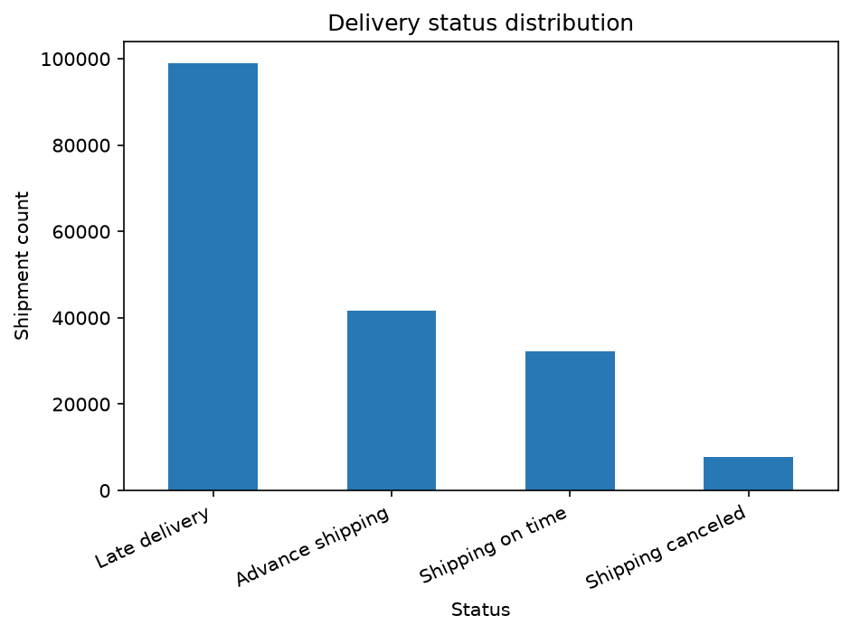
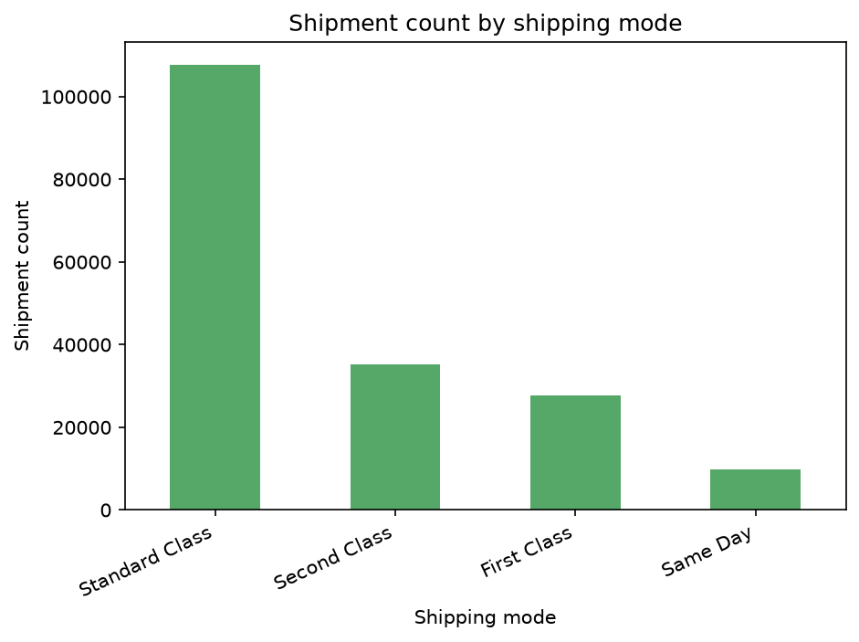
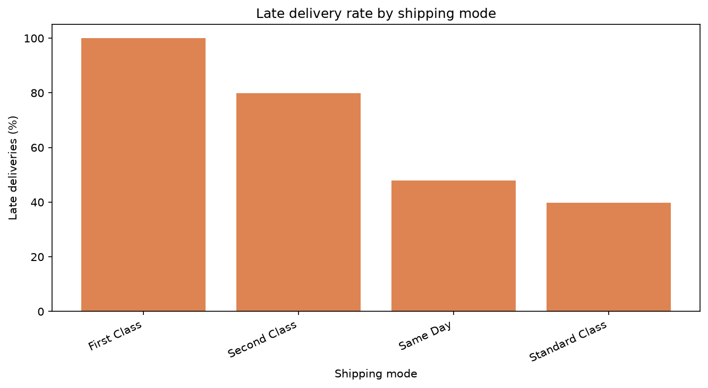
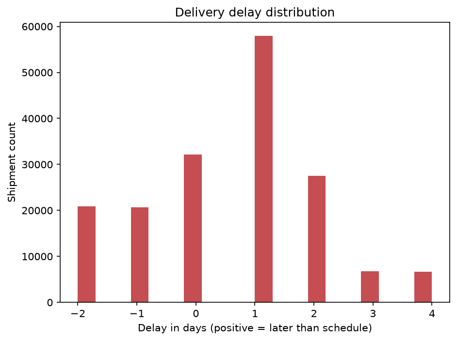

# Logistics Analysis Report

## Introduction and background
This project explores shipment delivery performance, shipping mix, delivery delays, and shipping costs to support evidence-based logistics planning.

## Problem statement and objectives
Operational teams need a repeatable way to inspect shipment data, measure service and cost KPIs, and identify improvement opportunities. Objectives are to validate incoming data, calculate available KPIs, visualize supported measures, and evaluate a cautious late-delivery model only when data is sufficient.

## Dataset description and source
- Input file: `logistics_data.csv`
- Dataset designation: **real**.
- Source: DataCo Smart Supply Chain dataset, Kaggle listing (CC0: Public Domain license shown by the listing at the time of analysis). The 95.9 MB source file remains local and is excluded from Git because it contains customer-identifying fields.
- Dataset rows are line-item records and are not necessarily unique physical shipments.

## Data cleaning methodology
Column names are matched through documented aliases. Recognized dates and operational numeric measures are parsed with invalid non-empty values reported as missing. Original rows and columns are retained; duplicates are reported, not removed. No cleaned source CSV is exported by default to avoid publishing potentially sensitive records.

Cleaning and data-quality notes:
- Parsed 'order date (DateOrders)' as a date; 0 non-empty value(s) were invalid.
- Retained all 180519 rows; 0 duplicate row(s) were identified but not removed.
- No rows or columns were silently dropped.

## KPI definitions and results
- **Total shipments:** number of input rows; duplicate records are retained.
- **On-time rate:** known on-time/early deliveries divided by shipments with a classifiable outcome.
- **Late rate:** known late deliveries divided by shipments with a classifiable outcome.
- **Average shipping cost:** arithmetic mean of parseable recognized shipping-cost values.
- **Average delivery time:** arithmetic mean of parseable actual delivery-time values in days.
- **Shipment count by mode:** rows per recognized shipping-mode category.

| KPI | Result |
|---|---:|
| Total shipments | 180519 |
| On-time delivery rate | 42.7% |
| Late delivery rate | 57.3% |
| Outcome records with known status | 172765 |
| Average shipping cost | Not available in this dataset |
| Average delivery time (days) | 3.50 |
| Average delay (days; positive means late) | 0.57 |
| Shipment count by mode | First Class: 27814, Same Day: 9737, Second Class: 35216, Standard Class: 107752 |

### Delivery performance by mode
| Shipping mode | Records | Known outcomes | Late rate | Avg. delay (days) |
|---|---:|---:|---:|---:|
| First Class | 27814 | 26513 | 100.0% | 1.00 |
| Same Day | 9737 | 9293 | 47.9% | 0.48 |
| Second Class | 35216 | 33806 | 79.8% | 1.99 |
| Standard Class | 107752 | 103153 | 39.8% | -0.01 |

## Exploratory data analysis and charts
### Delivery Status

Observed delivery-status counts: Advance shipping: 41592, Late delivery: 98977, Shipping canceled: 7754, Shipping on time: 32196.
### Shipping Mode Analysis

Observed shipment counts by mode: First Class: 27814, Same Day: 9737, Second Class: 35216, Standard Class: 107752.
### Late Delivery Rate By Mode

Compares late-delivery rates among records with a classifiable outcome in each mode.
### Delivery Delay Analysis

The plotted delay values are centered on an observed mean of 0.57 days; positive values mean late.

Interpretations are descriptive, not causal. Charts that could not be generated are omitted because their source fields were unavailable or empty.

## Machine learning methodology and evaluation
Model: Logistic Regression with median/mode imputation, numeric scaling, and one-hot encoding.
Target: late delivery (1) versus known on-time/early delivery (0).
Evaluation: chronological 75/25 holdout by shipment date.
Leakage controls: delivery outcome/status, explicit late-risk label, actual delivery time, schedule, and delay fields are excluded from predictors.
Predictors: Benefit per order, Order Item Discount, Order Item Discount Rate, Order Item Profit Ratio, Order Item Quantity, Sales, Order Item Total, Order Profit Per Order, shipment_month, shipment_day_of_week, Type, Category Name, Customer Segment, Department Name, Market, Order Region, Shipping Mode.
Train rows: 129572; test rows: 43193.
Holdout metrics:
  - accuracy: 0.6953
  - balanced_accuracy: 0.7217
  - precision: 0.8839
  - recall: 0.5377
  - f1: 0.6686
  - roc_auc: 0.7421
Metrics describe this dataset and split; they are not a guarantee of future performance.

## Exploratory clustering
Exploratory K-means clustering used 20000 deterministically sampled rows and 10 numeric feature(s): Days for shipping (real), Days for shipment (scheduled), Benefit per order, Order Item Discount, Order Item Discount Rate, Order Item Profit Ratio, Order Item Quantity, Sales, Order Item Total, Order Profit Per Order.
Features were median-imputed and standardized. Cluster IDs are descriptive, not quality rankings.
Cluster mean profiles:
         Days for shipping (real)  Days for shipment (scheduled)  Benefit per order  Order Item Discount  Order Item Discount Rate  Order Item Profit Ratio  Order Item Quantity  Sales  Order Item Total  Order Profit Per Order
cluster
0                            3.48                           2.91              80.41                37.95                      0.11                     0.27                 2.39 342.48            304.52                   80.41
1                            3.53                           2.95              23.11                11.96                      0.09                     0.19                 1.98 134.31            122.34                   23.11
2                            3.57                           3.01            -261.09                25.64                      0.10                    -1.27                 2.32 249.50            223.86                 -261.09
Validate whether these groupings are operationally meaningful before making decisions.

## Key findings
- The source contains 180,519 line-item records; 172,765 have a recognized delivery outcome.
- Among records with a known delivery outcome, 57.3% were late and 42.7% were on time or early.
- First Class had the highest observed late rate (100.0%; 26,513 known outcomes); investigate this pattern and validate status coding before changing service plans.
- The source does not provide shipping-cost values, so shipping costs and cost-versus-service trade-offs could not be measured.

## Recommendations
- Review delay and on-time rates by route, mode, and service commitment before adjusting schedules.
- Compare like-for-like shipping modes and lanes to identify cost/service trade-offs.
- Investigate recurring late-delivery causes with operational context before changing staffing or capacity.
- Validate any model on a later time period and monitor performance before operational use.
- Protect customer identifiers, addresses, and other sensitive fields when handling real datasets.

## Limitations
- Source datasets may use different names, units, label definitions, and outcome coverage.
- Unrecognized or absent fields cannot support the associated KPI or chart.
- Duplicate rows are intentionally retained pending domain review.
- Holdout model scores are dataset-specific and may not generalize; small datasets may not support a model.
- Synthetic dataset results are for software verification only.

## Conclusion
The analysis is designed to adapt to available columns, expose data-quality limitations, and avoid presenting unavailable measures as facts. Replace the test sample with an authorized operational dataset for business conclusions.

## References
- DataCo Smart Supply Chain dataset listing: https://www.kaggle.com/datasets/shashwatwork/dataco-smart-supply-chain-for-big-data-analysis
- pandas documentation: https://pandas.pydata.org/docs/
- scikit-learn documentation: https://scikit-learn.org/stable/
